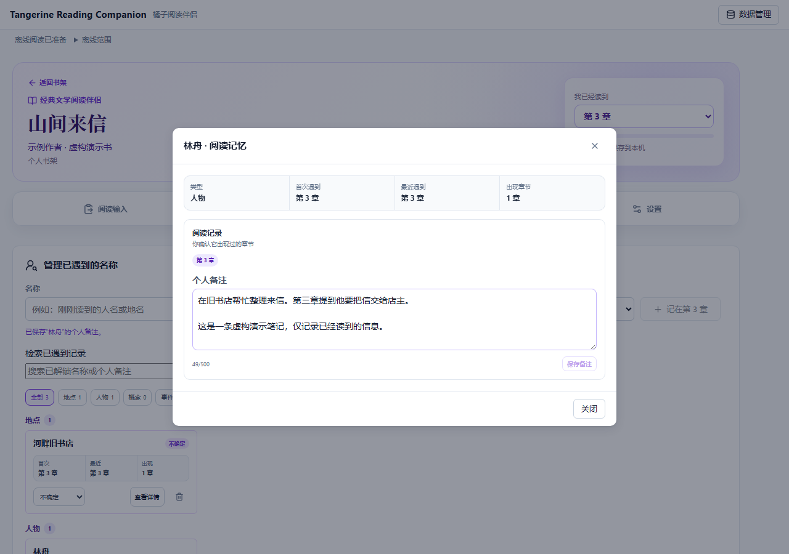

# 橘子阅读伴侣

**读长篇时，按章节记住已遇到的人物、地点和自己的笔记。**

“这个人前面出现过吗？”“上次读到哪里，发生了什么？”不用急着去网上搜剧情，先回顾自己读到这里留下的记录。

Tangerine Reading Companion 是一个中文阅读伴侣：你继续在纸书或原来的电子书应用里阅读，在这里记下名称、出现章节与备注。适合读人物较多的长篇、经常隔几天才继续阅读、希望减少搜索剧透的读者。

**无需账号 · 核心记录无需 AI · 数据保存在本机 · JSON 备份与迁移**

[开始使用](#快速开始) · [第一次记录](#第一次使用) · [数据与隐私](#数据隐私与限制) · [反馈问题](https://github.com/Manamiiii/TangerineReadingCompanion/issues) · [GPL v3](LICENSE)

> 当前提供 Web/PWA 试用版及可从源码构建的 Windows x64 安装候选。Windows 包未签名，尚未完成干净机器验收，也未发布正式 Release；APK / iOS 安装包尚未实现。本页尚不提供已验证的在线演示入口。



*实际界面，使用虚构测试书演示：在“已遇到”中查找名称、回顾出现章节、保存自己的备注。*

## 能帮你做什么

| 阅读时遇到的问题 | 在这里怎么做 |
|---|---|
| 人物、地点太多，记不清谁是谁 | 手动记录名称，或粘贴一小段内容匹配已有名称；补记出现章节和个人备注，之后按名称或备注检索 |
| 隔了一阵再读，想回顾到当前进度 | 设置“我已经读到”的章节，查看已遇到记录；退回较早章节时，较后章节的记录与位置隐藏 |
| 想理解故事中的现实地点 | 搜索并确认地点，保存到自己的地图；虚构或模糊地点只用明确标注的参考区域 |
| 想保留自己的阅读积累，或换浏览器、设备 | 导出 JSON 备份，在新环境中预览并合并导入 |

可选辅助包括截图文字识别（本机 OCR）、模型名称识别和当前内容依据摘录。**可以从头到尾只用手动记录，不配置模型。** 模型使用需要自备 API Key，可能产生服务商费用。

工具不提供书籍正文，不连接或读取微信读书账号，也不自动掌握整本书的剧情。进度控制帮助限制展示范围，不能保证用户输入或外部内容绝不剧透。

## 快速开始

**Windows 安装候选：** 如已取得维护者提供的 `TangerineReadingCompanion-<版本>-win-x64-Setup.exe`，核对 SHA-256 后双击安装，从开始菜单打开“橘子阅读伴侣”。无需 Node、Rust 或管理员权限。安装、迁移和验收见 [Windows 安装说明](docs/windows-installation.md)。安装版与网页版各自存储，通过 JSON 迁移，不会自动同步。正式下载以 [Releases](https://github.com/Manamiiii/TangerineReadingCompanion/releases) 的实际发布为准。

**网页版源码运行：**

需要 Node.js `^20.19.0 || >=22.12.0`，可使用 `.nvmrc` 指定的版本；用 Git 下载需要先安装 Git。首次安装依赖需要联网，不需要管理员权限或原生编译工具链。

```bash
git clone https://github.com/Manamiiii/TangerineReadingCompanion.git
cd TangerineReadingCompanion
npm ci
npm run dev
```

也可在 GitHub 点击 **Code → Download ZIP**，解压后在包含 `package.json` 的目录打开终端，从 `npm ci` 开始。安装失败时先核对 `node --version` 和网络。

打开 **http://localhost:5174/**，保持终端运行。按 `Ctrl+C` 停止服务。端口被占用会报错，不会悄悄换地址；如果已经运行本项目，直接打开原地址即可。

Windows PowerShell 若提示不允许执行 `npm.ps1`，使用 `npm.cmd ci` 和 `npm.cmd run dev`，无需修改系统执行策略。安装依赖后，也可双击仓库根目录的 `TangerineReadingCompanion.vbs`，查看启动状态并打开浏览器。这个快捷入口启动的是本地开发服务，不是原生安装包，开发模式不启用离线缓存。详见[运行与开发说明](docs/development.md)。

## 第一次使用

先用正在读的书完成一条记录，无需 API Key：

1. 点击“添加书籍”，填写书名、作者和章节数，点击“创建并开始阅读”；其他字段可以留空，AI 选项默认不勾选。
2. 先设置“我已经读到”的章节。
3. 到“已遇到”，输入一个刚读到的名称，选择类型，点击“记在第 N 章”。也可在“阅读输入”粘贴一小段文字并选中名称记录。
4. 点击该记录的“查看详情”，写一条“个人备注”并点击“保存备注”。刷新后，记录仍在；临时原文不会恢复。
5. 点击右上角“数据管理 → 导出备份”，确认 JSON 文件已经保存。下次从书架“继续上次阅读”进入。

想体验内置匹配，可以选择《飘》并在段落框输入“亚特兰大”；这仅用于验证名称匹配，不代表它在你选择的章节出现过。实际阅读中只记录你确实读到的内容。更详细的步骤见[试用说明](docs/trial-guide.md)。

### 可以用来读哪些书？

其他书可以创建个人书籍，自行积累名称与备注；没有自动匹配时，先手动记录即可，并非创建失败。

内置资料目前仅覆盖《飘》的指定版本：范纯海 / 夏旻译、长江文艺出版社、2018-05、ISBN 9787570202188，章节为 1–63。包含 40 个隐藏的按需匹配名称和部分独立背景说明，**不含完整人物关系、逐章剧情解读或已发布的章节事实**。

## 数据、隐私与限制

最需要记住的两点：**持续使用同一入口，定期保存 JSON 备份。** 网页版需保持同一浏览器和地址；Windows 安装版在当前系统账号下独立保存数据。本地存储不等于永远不会丢失数据。

本机安装路径在运行时确定，个人设置保存在当前使用环境的本机存储，不提交到 GitHub。维护与发布时的隔离规则见[本机私有信息说明](docs/local-privacy.md)。

<details>
<summary>展开查看存储、导入、OCR 和模型的具体边界</summary>

- **数据按使用环境隔离**：网页版的 `localhost`、`127.0.0.1`、不同端口、不同浏览器或部署域名不是同一个书架；Windows 安装版也有独立书架。迁移前先导出，再在目标环境导入；没有自动同步。
- **请保留 JSON 备份**：清理网站数据、无痕会话结束、浏览器回收存储都可能让记录丢失。持久存储申请不替代备份。备份含个人书目、备注和位置，请妥善保管。
- 导入先预览并要求导入前备份；同一 key 的整条记录会被覆盖，备份中没有的其他本机记录保留。它不逐字段合并，不能把旧备份当成“只添加新内容”。详见[数据与迁移](docs/data-sync.md)。
- 原文、截图、OCR 原文、模型临时结果及剧透授权不持久化，刷新、切书或切换章节会清空相关临时输入。你主动保存的名称、备注、封面，以及可选生成的隐藏名称词典会保留。
- 模型功能由你提供 API Key，可能产生服务商费用。仅在明确使用相关功能时外发；书目截图在模型配置完整时会把 OCR 文字发送到所选接口校对。接口必须允许浏览器跨域调用。模型名和免费额度以服务商控制台为准，见[模型配置](docs/model-provider-setup.md)。
- Key 只存放在当前 `sessionStorage`，不进入数据库或导出；浏览器恢复会话可能恢复会话存储。在共用电脑上用完应在设置中清空 Key 并保存。
- OCR 在设备上识别；网页版首次引擎加载可能需要联网，Windows 安装版随包提供引擎和语言资源。速度和准确率取决于设备及图片，识别后请核对。打开地图会访问外部瓦片服务，搜索会发送你提交的地名；地图和模型均不保证离线或始终可用。
- “试用反馈”导出的是单书诊断与阅读记录，**仍含个人备注，不是匿名文件，也不能用于恢复备份**。分享前检查内容，不要将完整备份或 Key 提交到公开 Issue。

</details>

## 安装、部署与常见问题

**可以直接下载 EXE / APK 吗？** Windows x64 安装候选已完成本机自动回归与 Windows CI 验证，当前等待维护者实际体验验收，安装包尚未公开上传。验收完成后再安排 Release 下载；目前可按[桌面开发说明](docs/native-development.md)从源码构建。APK、macOS 和 iOS 安装包尚未提供。浏览器支持时，也可将生产站点安装为 PWA，它仍使用对应浏览器的数据与权限。

**如何部署？** 运行 `npm ci`、`npm run build`，将生成的 `dist/` 部署到支持 HTTPS 的静态网站。不要把 `npm run dev` 暴露到公网，也不要直接双击 `dist/index.html`。仓库有 GitHub Pages 工作流，但不把它当作已经可用的在线演示：部署者需启用 Pages 的 GitHub Actions 来源，并检查工作流及最终网址。详见[部署说明](docs/development.md#部署)。

**能离线吗？** Windows 安装版随包提供阅读界面、内置资料和 OCR 资源，可离线记录与识别；更新需手动下载安装包。网页版生产站点显示“离线阅读已准备”后，阅读界面、内置资料与本机记录可离线使用，但首次 OCR 不在保证范围内。开发模式不启用网页离线缓存；网页新版就绪会提示手动更新，刷新前请处理好临时输入。两种版本的模型和在线地图都需要对应网络服务。

**粘贴按钮不工作？** 先直接点击段落框按 `Ctrl+V`（macOS 用 `⌘V`）。自动读取剪贴板受浏览器权限及 HTTPS/localhost 环境限制。

**个人书籍没有自动匹配？** 未准备词典时属于正常情况，可以先手动记录；已有名称之后会参与本机匹配。AI 辅助在书内“设置”配置，完全可选。

## 反馈与参与

遇到问题，可以[提交 Issue](https://github.com/Manamiiii/TangerineReadingCompanion/issues/new)：说明操作步骤、期望与实际结果、系统和浏览器版本；可附去除私人内容的截图。**不要公开 Key、书籍原文、完整备份或未经检查的反馈包。**

也欢迎分享具体阅读场景，例如“隔了一周继续读时，想先找到上次写的备注”。项目优先完善核心记录与回顾流程；模型、地图等外部服务的问题请同时说明使用的服务商，但不要提供凭据。

## 开发

共享静态前端使用 Vite、React、Dexie、Leaflet；Windows 桌面壳使用 Electron，复用同一阅读核心。没有账号系统和后端。依赖与版本以 `package.json` 和锁文件为准。

<details>
<summary>开发命令与目录结构</summary>

| 命令 | 用途 |
|---|---|
| `npm run dev` | 本地开发，固定端口 5174 |
| `npm run lint` | 静态检查 |
| `npm run check:privacy` | 检查源码与发布资源中的常见私有信息；构建前自动执行 |
| `npm test` | 领域、数据边界、迁移、离线及启动器测试 |
| `npm run test:e2e` | 独立 Chromium 浏览器测试；首次先 `npx playwright install chromium` |
| `npm run build` | 生成 `dist/` |
| `npm run preview -- --host localhost --port 5174 --strictPort` | 本机验证生产构建；先停止开发服务 |
| `npm run check:packages` | 校验正式资料包 |
| `npm run check:native` | 只读检查当前 Electron Windows 构建依赖，不安装工具 |
| `npm run desktop` | 构建并打开桌面窗口；使用本机安装版的数据目录 |
| `npm run pack:win` / `npm run dist:win` | Windows 应用目录 / x64 Setup 与 SHA-256，不发布 |
| `npm run check:desktop-package` | 检查打包白名单、源码一致性和常见隐私信息 |
| `npm run test:desktop` | 隔离 profile 下验证实际打包 EXE，包含离线 OCR 和备份 |
| `npm run build:installer-fixture` / `npm run test:installer` | 生成低版本号测试样本 / 安装升级卸载重装回归 |
| `npm run audit:quality` / `npm run audit:links` | 资料覆盖与来源审计，后者访问来源链接 |
| `npm run preview:data` / `npm run check:preset` | staging 生成预览 / dry-run 检查差异 |
| `npm run apply:preset` | 仅在显式批准后发布正式资料 |

```text
src/platform/                     # 平台输入与导出适配
desktop/                          # Electron 外壳、资源安全规则与安装器保护
scripts/desktop/                  # 打包核对、桌面与安装生命周期测试
src/features/reading-companion/    # 阅读、书架、记录、地图与资料规则
src/features/model/               # 可选模型连接与配置
src/features/ocr/                 # 本机 OCR
src/components/                   # 数据管理、离线状态与公共组件
src/styles/                       # 按功能拆分的样式
public/presets/reading-companion/  # 正式版本化资料
public/icons/                     # 网页与 PWA 图标
assets/                           # 图标原图和 Windows ICO
scripts/reading-companion/        # 资料 staging、校验与发布
scripts/build-offline.mjs          # 离线资源与内容指纹
scripts/build-licenses.mjs         # 构建时收集依赖许可证与 NOTICE
licenses/                         # npm 包未附带的上游许可补充文本
scripts/launch-desktop.ps1         # Windows 本地启动器
scripts/tests/、tests/e2e/         # Node 与浏览器测试
docs/                             # 产品、安全与开发说明
```

[系统能力](docs/system-capabilities.md) · [产品与架构](docs/product-and-architecture.md) · [模型边界](docs/model-prompts.md) · [运行与开发](docs/development.md) · [原生开发](docs/native-development.md)

</details>

## License

本项目原创代码与文档采用 **GNU General Public License v3.0 only**（`GPL-3.0-only`），完整条款见 [LICENSE](LICENSE)。Copyright (C) 2026 Tangerine Reading Companion contributors.

欢迎使用、学习、修改与分享，也允许商用。分发本项目或受 GPL 约束的修改版时，须保留许可与版权声明，并依 GPL v3 提供相应源码；仅公开压缩后的构建产物不足以履行源码义务。软件按原样提供，不作担保。以上为简要说明，以许可证全文为准。

第三方依赖、OCR 语言资源、地图和书籍参考资料保留各自的授权条件，项目许可证不重新授权这些内容，也不要求你公开自己的阅读记录。来源与分发注意事项见 [第三方许可说明](THIRD_PARTY_NOTICES.md)；图标来源见 [assets/README.md](assets/README.md)。
